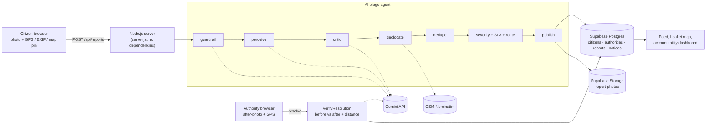

# Nagrik Sahayak – Transparent Civic Grievance & Infrastructure Triage

Citizens report civic issues with a photo. An AI agent checks, classifies, scores, de-duplicates and routes each report, and a complaint counts as fixed only when **AI verifies the fix** by comparing before/after photos taken at the same spot. The public dashboard shows **claimed vs AI-verified closure rates** per department, which exposes "fake closures".

Built for Forge Gen AI Buildathon (Theme 1: Civic Pulse) by Team NeuroSync, IIT Kharagpur. Live data comes only from real reports filed at IIT Kharagpur and Kharagpur town; the system itself works for any location in India.

## Features
- **Report:** photo (required) + caption; location from device GPS, the photo's EXIF GPS, a map pin, or an address search (manual locations are labelled "location set manually"). No default location is ever assumed.
- **AI triage agent** with a visible **Agent trace** for every report (see below).
- **Duplicate merge:** the same category within 150 m merges into one report and raises its priority.
- **Authority workflow:** acknowledge, start work, resolve with an after-photo.
- **AI fix verification:** verified only if Gemini says the issue is fixed with confidence >= 0.6 **and** the after-photo was taken within 200 m. If the AI is unavailable or unsure the closure is recorded as **claimed (unverified)**, never as fixed. Citizens can confirm or dispute; 3 disputes reopen the issue.
- **Public accountability dashboard:** Leaflet map with severity pins, claimed vs AI-verified closure rate per department, AI-rejected closure claims, rankings by state / district / city / locality.
- Anonymous discussion, upvotes with on-site confirmation, abuse flagging with strikes.

## Agent pipeline
| Step | What it does | Tool |
|---|---|---|
| guardrail | Redacts phone numbers/emails, detects prompt injection, rejects non-civic or unsafe photos (nothing is stored) | local rules + Gemini |
| perceive | Category, visual evidence, severity 1–5, confidence, reasoning (blind to the citizen's chosen category) | Gemini vision |
| critic | Re-prompts once on invalid JSON, category mismatch or confidence < 0.6; still unsure → human review queue | Gemini vision |
| geolocate | Reverse-geocodes the coordinates (1 req/s, cached, labelled fallback) | OSM Nominatim |
| dedupe | Finds an open report of the same category within 150 m | haversine distance |
| route | SLA from category, shortened for severity 4–5; department key from category; jurisdiction from the citizen's area; reasoning cited | rules |
| publish | Saves the report and photos | Supabase |

Gemini calls use a JSON response schema and temperature 0. On HTTP 429/5xx or timeout the call retries with the backup key, then the fallback model.

## Architecture


## Run locally
Requires Node.js 18+. No npm packages.
```bash
cd civic-triage
cp .env.example .env   # fill in the values
node server.js         # http://localhost:3000
```
Without `SUPABASE_*` the app stores data in `./data` (development only). Without Gemini keys reports still publish but go to human review, and closures stay "claimed".

## Environment variables
| Variable | Required | Purpose |
|---|---|---|
| `GEMINI_API_KEY` | yes | Google AI Studio key |
| `GEMINI_API_KEY_BACKUP` | recommended | used on 429/5xx |
| `GEMINI_MODEL` | yes | current Gemini Flash model name |
| `GEMINI_MODEL_FALLBACK` | recommended | used if the main model fails |
| `GEMINI_TEMPERATURE` | no | default 0 |
| `SUPABASE_URL` | yes (prod) | project URL |
| `SUPABASE_SERVICE_ROLE_KEY` | yes (prod) | server-side only, never exposed to the browser |
| `SUPABASE_BUCKET` | no | default `report-photos` (public bucket) |
| `NOMINATIM_USER_AGENT` | recommended | identifies the app to Nominatim |
| `DEPARTMENTS_JSON` | no | official department names + source URLs |
| `GEMINI_THINKING_LEVEL` | no | e.g. `low` for faster Gemini 3 responses |

### Supabase setup
1. Open **SQL Editor**, paste the contents of [`supabase.sql`](supabase.sql) and run it. It creates four tables that are readable in the **Table Editor**:
   - `citizens`: id, phone, email, state, district, city, locality, strikes
   - `authorities`: id, office, level, department, state, district, city, phone, email
   - `reports`: id, status, category, severity, caption, address, lat/lng, department, SLA, AI confidence and reasoning, closure claims, verdict, photo URLs, reporter
   - `notices`: id, kind, status, message, report
   Each row also keeps the full record in a `data` column; the other columns are generated from it by Postgres. The script copies any rows from the older `app_docs` table, removes only the unused setup table, and is safe to run again.
2. Create a **public** Storage bucket named `report-photos`.
3. Only the server (service role key) can read or write the tables (row level security is on, no public policies).

## Deploy on Render
1. New → Web Service → connect `NeuroSync26/neurosync`, branch `feature/civic-triage` (or `main` after merging).
2. Root Directory: `civic-triage` · Runtime: Node · Build Command: `npm install` · Start Command: `node server.js` · Instance: Free.
3. Add the environment variables above, then deploy.
4. Check `https://<your-app>.onrender.com/api/health` shows `"storage":"supabase","ai":true`. If storage is `local`, the Supabase variables are missing; if the service keeps restarting, check the logs (usually `supabase.sql` has not been run).
5. The free tier sleeps when idle: open `/api/health` a minute before a demo.

## Data sources
- **Citizen reports:** real photos and locations submitted through the app. There is **no seed, mock or demo data**; empty views say "No reports yet".
- **Google Gemini API:** vision triage, critic and before/after verification (model name stored with each verdict).
- **OpenStreetMap Nominatim:** reverse geocoding and address search (© OpenStreetMap contributors, ODbL). Source and fetch time are stored with every address.
- **OpenStreetMap tiles via Leaflet** for maps.
- **Supabase:** Postgres and Storage.
- `hierarchy.js`: names of Indian states/UTs, major districts and some localities, used only for choosing a user's area and for dashboard grouping. It is not used for any report location or statistic.
- **Departments:** generic function labels (e.g. "Sanitation & waste") unless an official name and its published source are configured.
